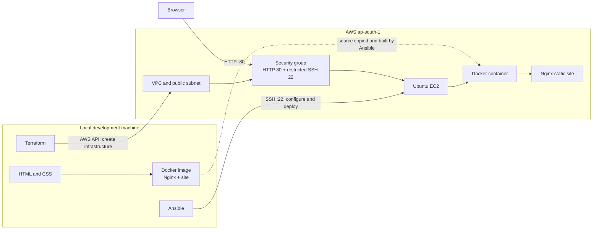

# Automated Docker Application Deployment on AWS

A learning-focused DevOps project that packages a static website with Docker and Nginx, provisions an AWS EC2 environment with Terraform, and configures and deploys the application with Ansible.

> **Status:** Checkpoint 1 — architecture and repository foundation.
>
> **AWS region:** Mumbai (`ap-south-1`). No cloud resources have been created yet.

## Project goal

Build a small but complete and repeatable deployment workflow:

1. Develop and test a static site locally.
2. Package the site as a Docker image served by Nginx.
3. Define AWS networking and an EC2 instance as Terraform code.
4. Configure the instance and deploy the container with Ansible.
5. update the page and repeat the deployment safely.
6. Destroy every project resource with Terraform.

The source project requirements are in [project_synopsis.pdf](project_synopsis.pdf).

## Architecture



### The three flows

| Flow | Path | Purpose |
|---|---|---|
| Build | HTML/CSS → Docker image | Package the application consistently |
| Automation | Terraform → AWS; Ansible → EC2 | Create infrastructure, then configure it |
| Request | Browser → EC2 port 80 → container → Nginx | Deliver the webpage to a user |

## Which tool owns what?

| Tool | Responsibility | What it does not own |
|---|---|---|
| Git | Source history and reviewable changes | Secrets, generated state, or cloud resources |
| Docker | Application image and container runtime | AWS infrastructure |
| Nginx | HTTP serving inside the container | EC2 creation or host configuration |
| Terraform | Desired AWS infrastructure and its lifecycle | Commands run inside the server |
| Ansible | Idempotent host configuration and application deployment | AWS resource state |
| AWS | Compute, networking, storage, and public connectivity | Local source history |

## Planned repository layout

```text
.
├── app/                  # Static website and Docker build files
├── terraform/            # AWS Infrastructure as Code
├── ansible/              # Server configuration and deployment automation
├── docs/
│   ├── LEARNING_GUIDE.md # Concepts, commands, checks, and observations
│   └── screenshots/      # Sanitized demonstration evidence
├── .gitignore            # Secret and generated-file protection
├── project_synopsis.pdf  # Original requirements
└── README.md
```

## Learning workflow

Every checkpoint follows the same loop:

1. **Understand** the concept and purpose.
2. **Predict** what the command or change should do.
3. **Execute** one controlled step.
4. **Inspect** its output rather than assuming success.
5. **Explain** the observed result.
6. **Record** evidence and commit a safe milestone.

## Planned checkpoints

- [x] Understand the architecture and initialize a safe repository.
- [ ] Install and verify the local toolchain.
- [ ] Build the responsive static webpage.
- [ ] Build and test the Docker image locally.
- [ ] Configure secure AWS access, billing alerts, and the SSH key.
- [ ] Define and validate the Terraform infrastructure.
- [ ] Review the plan and provision AWS.
- [ ] Configure and deploy with Ansible.
- [ ] Verify idempotence and repeatable redeployment.
- [ ] Complete evidence and documentation.
- [ ] Destroy and verify all AWS resources.

## Safety rules

- Never commit AWS credentials, private SSH keys, real `*.tfvars`, Terraform state, saved plans, or generated Ansible inventory.
- Never paste secret access keys into documentation or screenshots.
- Do not use the AWS root user for command-line automation.
- Restrict SSH to the learner's current public IPv4 `/32`; never expose port 22 to the world.
- Review `terraform plan` before every apply or destroy.
- Treat Docker group membership as root-equivalent access.
- Verify current AWS credits and prices; “Free Tier” is not a guarantee of zero cost.
- Destroy the demonstration infrastructure when it is no longer required.

## Current local assessment

- OS: Zorin OS 18.1 (`x86_64`).
- Available: Docker CLI/Engine packages, OpenSSH, Git, curl, and Python 3.
- Docker service: installed but not currently enabled/running.
- To install: Terraform, Ansible, and AWS CLI v2.
- AWS credentials and a project SSH key: not configured yet.

Detailed checkpoint notes are kept in [docs/LEARNING_GUIDE.md](docs/LEARNING_GUIDE.md).
